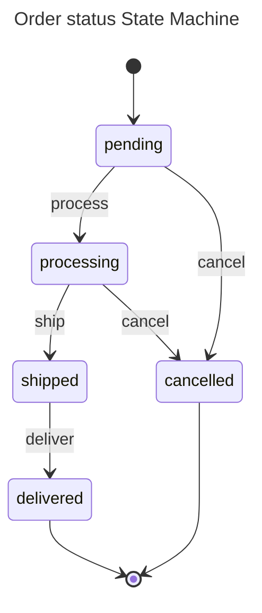
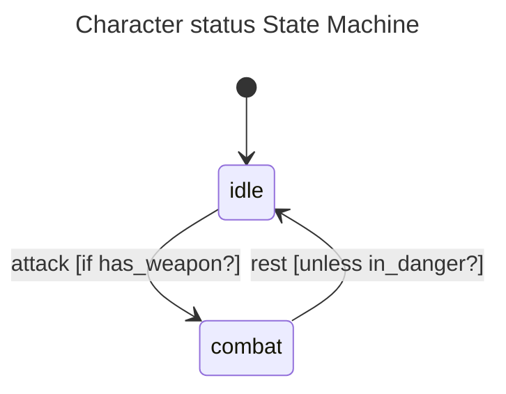

# StateMachines::Mermaid

[](https://github.com/state-machines/state_machines-mermaid/actions/workflows/ruby.yml)
[](https://rubygems.org/gems/state_machines-mermaid)
[](https://www.ruby-lang.org)

Mermaid diagram renderer for [state_machines](https://github.com/state-machines/state_machines). Generate Mermaid state diagrams from your state machines.

## Installation

Add this line to your application's Gemfile:

```ruby
gem 'state_machines-mermaid'
```

And then execute:

    $ bundle install

Or install it yourself as:

    $ gem install state_machines-mermaid

## Usage

### Basic Usage

Requiring the gem changes no global state. Choose the Mermaid renderer for
`Machine#draw` (and `State`, `Event` and `Branch#draw`), as the core intends,
or call `StateMachines::Mermaid::Renderer.draw_machine(machine)` directly.

```ruby
require 'state_machines-mermaid'

StateMachines::Machine.renderer = StateMachines::Mermaid::Renderer

class Order
  state_machine :status, initial: :pending do
    event :process do
      transition pending: :processing
    end

    event :ship do
      transition processing: :shipped
    end

    event :deliver do
      transition shipped: :delivered
    end

    event :cancel do
      transition [:pending, :processing] => :cancelled
    end
  end
end

# Writes the Mermaid diagram to $stdout (or io:)
Order.state_machine(:status).draw
```

This generates (the title goes in front matter, where Mermaid reads it):



### With Conditions

```ruby
class Character
  state_machine :status, initial: :idle do
    event :attack do
      transition idle: :combat, if: :has_weapon?
    end

    event :rest do
      transition combat: :idle, unless: :in_danger?
    end
  end
end

# Generates transitions with their conditions
Character.state_machine(:status).draw(show_conditions: true)
```

Output includes conditions (state guards such as `if_state:` too):



An Array condition shows each of its conditions: `if: %i[armed ready]` reads
`[if armed && if ready]`, as the core requires all of them (and none of an
`unless:` Array). A String condition is code, shown as one term: `[if (a || b)]`.

### Show Callbacks

```ruby
class Character
  state_machine :status do
    before_transition on: :attack, do: :draw_weapon
    around_transition on: :attack, do: :stance
    after_transition on: :attack, do: :shout
  end
end

# Include callback information in the diagram
Character.state_machine(:status).draw(show_callbacks: true)
```

Each transition lists the callbacks the core runs on it, before, around, then
after:

```mermaid
  idle --> combat : attack / before draw_weapon, around stance, after shout
```

### Parts of a Machine

The core draws one state, event or branch through the same renderer: the
transitions it involves and the states they connect.

```ruby
machine = Character.state_machine(:status)

machine.states[:combat].draw(nil, show_conditions: true)
machine.events[:attack].draw(nil)
machine.events[:rest].branches.first.draw(nil, machine.events[:rest], [])
```

### Output to File

```ruby
File.open('state_diagram.mmd', 'w') do |file|
  Order.state_machine(:status).draw(io: file)
end
```

### Integration with Mermaid Tools

The generated output is compatible with:

- [Mermaid Live Editor](https://mermaid-js.github.io/mermaid-live-editor/)
- GitHub Markdown (renders Mermaid diagrams natively)
- Various documentation tools (GitLab, Notion, etc.)
- Mermaid CLI for generating PNG/SVG files

### Example: Complex State Machine

```ruby
class Dragon
  state_machine :mood, initial: :sleeping do
    state :sleeping, :hunting, :hoarding, :rampaging

    event :wake_up do
      transition sleeping: :hunting, if: :hungry?
      transition sleeping: :hoarding, if: :treasure_nearby?
    end

    event :find_treasure do
      transition hunting: :hoarding
      transition hoarding: same # Keep hoarding
    end

    event :enrage do
      transition any - :rampaging => :rampaging
    end
  end
end

Dragon.state_machine(:mood).draw(show_conditions: true)
```

## Features

- Generates valid Mermaid state diagram syntax, checked with Mermaid's own parser
- Puts the diagram title in front matter (`title:`), as the mermaid gem does
- Draws a whole machine, or one state, event or branch (`Branch#draw`)
- Marks the initial state and final states (states with no way out)
- Shows transition conditions (if/unless and state guards) with `show_conditions: true`
- Handles self-transitions (loopbacks)
- State names Mermaid cannot read as plain names (`waiting-for-input`, or
  keywords such as `end`) are aliased by their bytes in hex and shown by name:
  `state "waiting-for-input" as state_77616974...`
- Text Mermaid would read as syntax (quotes, `;`, `#`, line breaks) is written
  as numeric entities (`#59;`), which Mermaid shows as the character
- Optional callback visualization
- Keeps no state between draws: each draw renders its own builder, so draws
  from several threads never mix
- `format:` other than `:mermaid` raises `ArgumentError`

## Development

After checking out the repo, run `bundle install`, then `bundle exec rake` for the tests and RuboCop
(`bundle exec rake minitest` runs the tests with plain Minitest).

## Contributing

Bug reports and pull requests are welcome on GitHub at https://github.com/state-machines/state_machines-mermaid.

## License

The gem is available as open source under the terms of the [MIT License](https://opensource.org/licenses/MIT).
